# Vinyl Collection

A web application for managing a personal vinyl record collection, organizing music into playlists and boxes, and planning playback sessions.

The application integrates with the Discogs API and provides an interface available in English and Polish.

## Screenshots

### Music Collection

Manage your personal vinyl record collection, search for albums and releases using the Discogs API, and explore detailed album information. Organize your records into custom boxes and create playlists to plan your music sessions. Use playback settings to configure track transitions and check the total duration of your playlists.

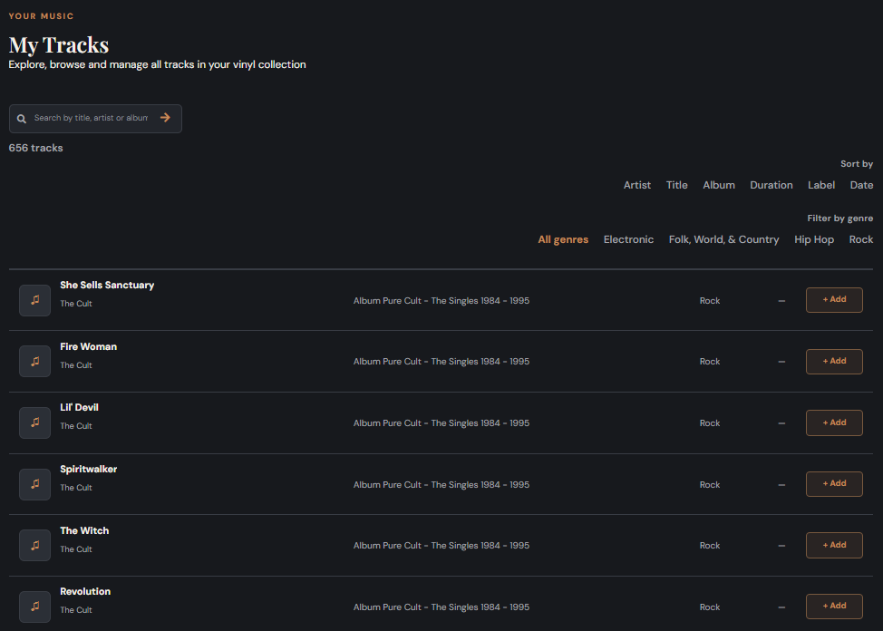

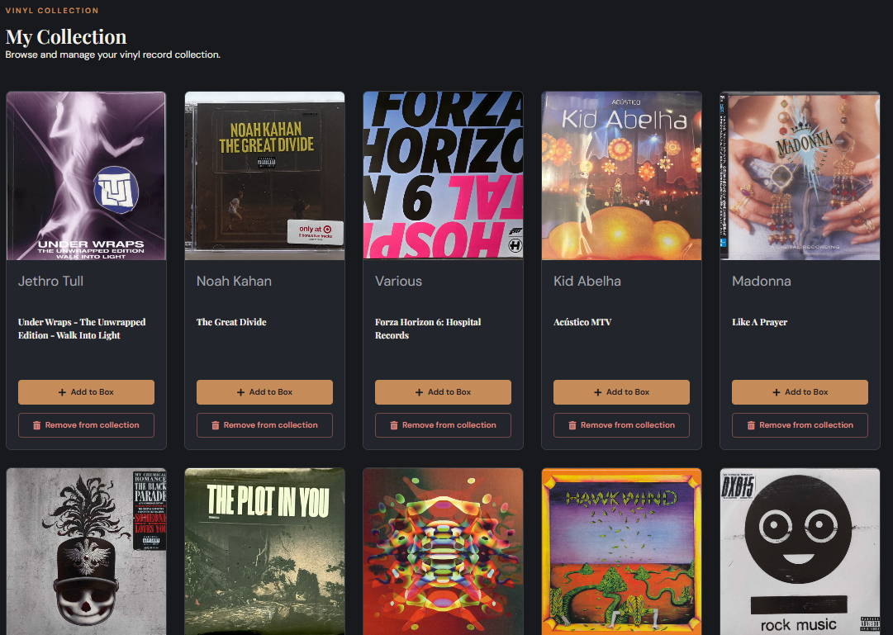

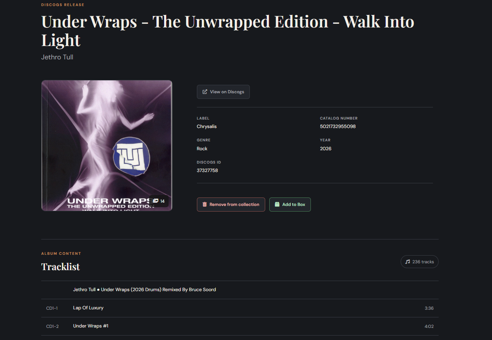

### Playlists and Playback

Create and manage playlists, organize tracks and configure playback settings, including transitions between tracks.

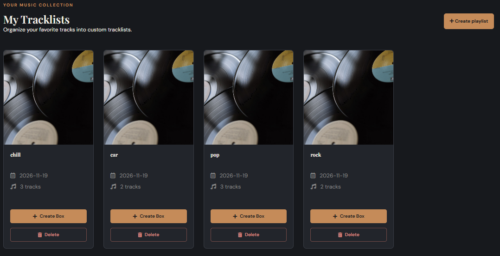

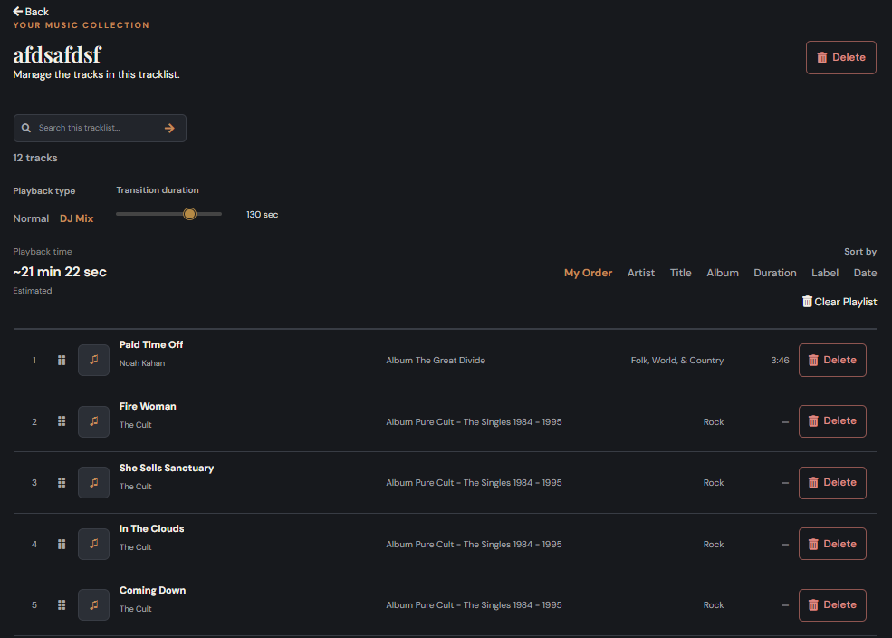

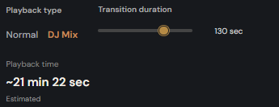

### Boxes

Organize records into boxes and manage your collection.

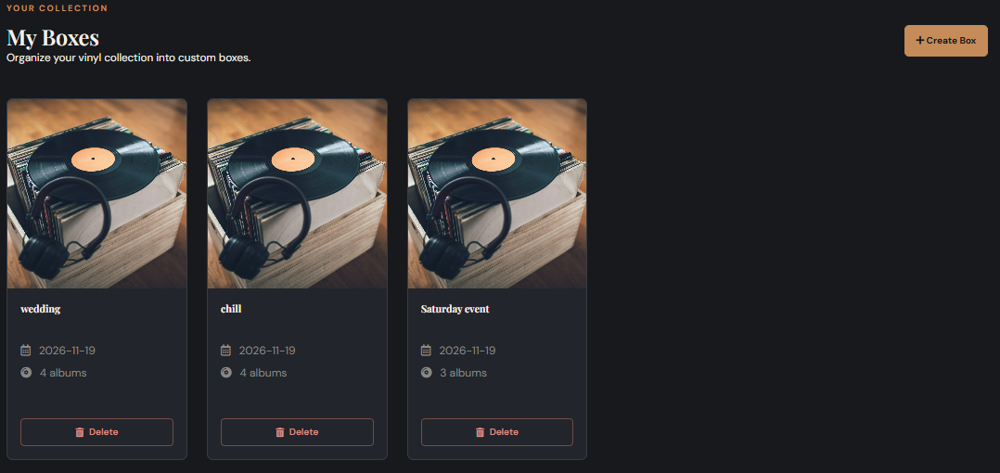

### Authentication

User registration and login.

<p align="center">
  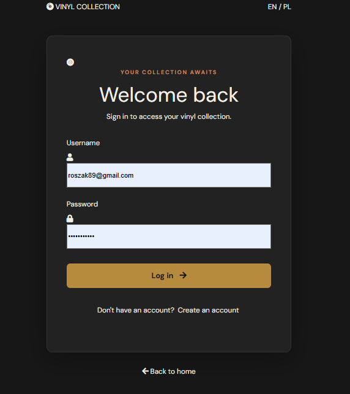
  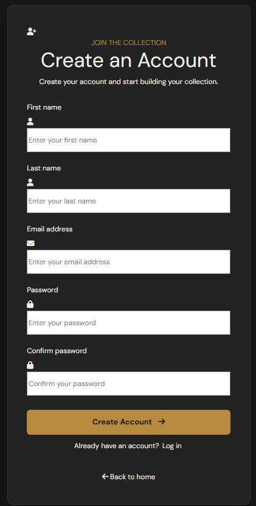
</p>

### Additional Features

- **Discogs integration and search** – search for music releases and access information through the Discogs API.
- **Internationalization (i18n)** – the application interface is available in English and Polish.
- **Notifications** – provide feedback about application actions and events.
- **Dynamic modals** – interactive dialogs used throughout the application.

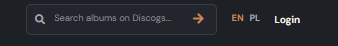

<p align="center">
  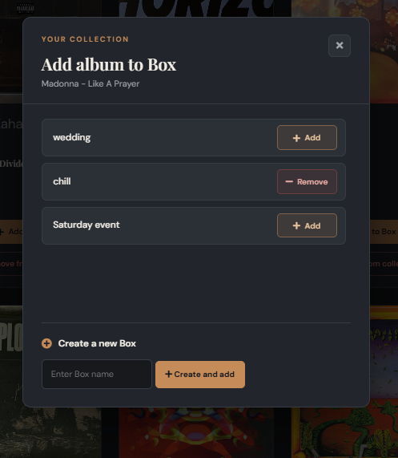
</p>

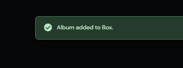

## Features

### Collection Management

- Manage a personal vinyl record collection.
- Browse and search records.
- View album details.
- Track record condition.
- Maintain a wishlist.

### Playlists and Boxes

- Create and manage playlists.
- Organize records into boxes.
- Add and manage tracks within playlists.
- Configure playback settings.
- Track playlist duration.

### Playback Planning

- Plan music sets using different playback profiles.
- Configure transitions between tracks.
- Organize music for different types of sessions.

### Integration and User Experience

- Discogs API integration.
- Discogs-related search and language settings.
- English and Polish interface.
- Dynamic modals and notifications.

### User Management

- User registration and login.
- Authentication and authorization.
- Separate USER and ADMIN roles.

## Tech Stack

- **Backend:** Java, Spring Boot, Spring MVC
- **Security:** Spring Security
- **Persistence:** Spring Data JPA, Hibernate
- **Database:** MySQL 8
- **Database migrations:** Flyway
- **Frontend:** JSP, HTML, CSS, JavaScript
- **External API:** Discogs API
- **Build tool:** Maven
- **Containerization:** Docker, Docker Compose

## Getting Started

The application can be run locally using Docker Compose.

### Prerequisites

- Docker Desktop or Docker Engine
- Docker Compose
- Discogs API credentials

### 1. Clone the repository

```bash
git clone https://github.com/markross89/vinyl-collection.git
cd vinyl-collection
```

### 2. Obtain Discogs API credentials

The application requires your own Discogs API credentials to enable integration with the Discogs API.

To obtain your credentials:

1. Create a free account or log in at [Discogs](https://www.discogs.com/).
2. Open [Discogs Developer Settings](https://www.discogs.com/settings/developers).
3. Select **Create an Application**.
4. Enter an application name and description.
5. Create the application.
6. Copy your **Consumer Key** and **Consumer Secret**.

You will need both values to configure the application in the next step.

### 3. Configure environment variables

Create a local `.env` file based on the provided example:

```bash
cp .env.example .env
```

On Windows PowerShell:

```powershell
Copy-Item .env.example .env
```

Open `.env` and provide your own credentials:

```dotenv
MYSQL_ROOT_PASSWORD=your_root_password
MYSQL_PASSWORD=your_mysql_password

DISCOGS_KEY=your_discogs_key
DISCOGS_SECRET=your_discogs_secret
```

Replace the example values with your actual database passwords and Discogs API credentials.

**Important:** Never commit your `.env` file or publish your database passwords and Discogs API credentials.

### 4. Build and start the application

Run the following command from the project root directory:

```bash
docker compose up --build -d
```

Docker Compose will:

- Build the Spring Boot application image.
- Start the MySQL 8 database container.
- Wait for the database health check.
- Start the application container.

### 5. Open the application

Once the containers are running, open:

[http://localhost:8080/home/start](http://localhost:8080/home/start)

### 6. Check container status

```bash
docker compose ps
```

To view application logs:

```bash
docker compose logs -f app
```

To view database logs:

```bash
docker compose logs -f mysql
```

### 7. Stop the application

```bash
docker compose down
```

The MySQL database uses a Docker volume to persist data between container restarts.

**Note:** Running `docker compose down -v` removes the database volume and its stored data. Avoid this command unless you intentionally want to delete the database.

## Environment Variables

The `.env.example` file contains the variables required to configure the application.

| Variable | Description |
|---|---|
| `MYSQL_ROOT_PASSWORD` | MySQL root account password |
| `MYSQL_PASSWORD` | Password for the application database user |
| `DISCOGS_KEY` | Discogs API consumer key |
| `DISCOGS_SECRET` | Discogs API consumer secret |

The database name and application database username are configured in `compose.yaml`.

## Database

- MySQL 8 is used as the relational database.
- Flyway manages database schema migrations.
- Hibernate validates the database schema on application startup.
- Database data is persisted using a Docker named volume.

## Project Structure

```text
vinyl-collection/
├── docs/
│   └── images/
├── src/
│   ├── main/
│   │   ├── java/
│   │   │   └── com/example/marek/
│   │   │       ├── config/
│   │   │       ├── controller/
│   │   │       ├── dto/
│   │   │       ├── entity/
│   │   │       ├── integration/
│   │   │       │   └── discogs/
│   │   │       ├── repository/
│   │   │       ├── security/
│   │   │       └── service/
│   │   ├── resources/
│   │   │   └── db/
│   │   │       └── migration/
│   │   └── webapp/
│   │       ├── WEB-INF/
│   │       │   └── views/
│   │       └── resources/
│   └── test/
│       └── java/
│           └── com/example/marek/
│               └── MarekApplicationTests.java
├── .env.example
├── .gitignore
├── compose.yaml
├── Dockerfile
├── pom.xml
└── README.md
```

## Roadmap

Planned improvements and future features:

- [ ] Code cleanup and refactoring
- [ ] Implement pagination
- [ ] Add PDF export and printing for collections, boxes, and playlists
- [ ] Create an administrator panel
- [ ] Expand automated test coverage

## Author

**Author:** [markross89](https://github.com/markross89)